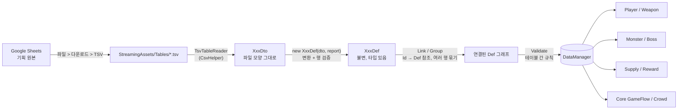

# 데이터 파이프라인: TSV → DTO → Def → DataManager

> 담당: 코어 · 최종 수정: 2026-10-19

## 한눈에 보기



| 단계 | 위치 (`Assets/Scripts/Core/Data/`) | 책임 | 하지 않는 것 |
|---|---|---|---|
| 원본 | `Assets/StreamingAssets/Tables/*.tsv` | 사람이 편집. 1행 헤더, `#` 주석 행 허용 | — |
| Read | `Loading/TsvTableReader` | TSV → `List<Dto>`. 깨진 행은 줄 번호와 함께 보고하고 계속 | 값 의미 해석 |
| DTO | `Dtos/*Dto` | 헤더와 1:1 public 필드. enum·리스트는 **문자열 그대로** | 검증, 로직 |
| Def | `Defs/*Def` | 문자열 → enum 변환, 행 단위 검증, 파생값(`FireInterval`) | 런타임 상태 보관 |
| Link/Group | `DataManager` | 숫자 참조 → Def 참조, 묶음 생성 (몬스터→스킬, 라운드→생성 규칙, 강화→레벨 트랙) | — |
| Validate | `DataManager.Validate` | 테이블 간 규칙 (보스 패턴 3개 이상, 강화 레벨 연속 등) | — |

`StreamingAssets` 는 Unity 예약 폴더라 팀 폴더 규칙(에셋 종류별 최상위)의 예외다. 실행 중 파일을 직접 읽으려면 이 위치여야 한다.

## 테이블 → Def 대응

| 테이블 | Def | 조회 | 관련 백로그 |
|---|---|---|---|
| PlayerTable | `PlayerDef` (+ `Rifle`, `Grenade` 링크) | `DataManager.Player` | BL-001·002·005·006 |
| WeaponTable | `WeaponDef` | `Weapons.Get(2001)` | BL-003·004 |
| GrenadeTable | `GrenadeDef` | `Grenades.Get(2101)` | BL-005 |
| MonsterTable | `MonsterDef` (+ `Skills`, `EntranceSkill`, `PatternSkills`) | `Monsters.Get(3001)` | E3, E5 |
| MonsterSkillTable | `MonsterSkillDef` | `monster.FindSkill("Charge")`, `monster.PickPattern(r)` | BL-011, 023~027 |
| RoundTable | `RoundDef` (+ `Boss`, `SpawnRules`) | `DataManager.GetRound(n)` | BL-015·018·021·032 |
| CrowdSpawnTable | `CrowdSpawnRuleDef` | `round.SpawnRules` | BL-015 |
| SupplyTable | `SupplyDef` | `SupplyDef.Pick(Supplies.All, r)` | BL-018·019 |
| UpgradeTable | `UpgradeDef` → `UpgradeTrackDef` | `UpgradeTracks.Get(UpgradeType.ReloadSpeed)` | BL-030·031 |
| SoundTable | `SoundDef` | `Sounds.Get("sfx_rifle_fire")` | — |
| ConfigTable | `GameConfig` | `Config.GetFloat(GameConfig.SpawnSafeRadius)` | 여러 개 |

## 사용 예

```csharp
using HybridShooter.Core.Data;
using HybridShooter.Core.Data.Defs;

// 플레이어 / 무기
PlayerDef player = DataManager.Player;
WeaponDef rifle = player.Rifle;
float interval = rifle.FireInterval;                       // 60 / RPM

// 강화 적용 (BL-031) — IUpgradeState 와 조합
var upgrades = ServiceLocator.Get<IUpgradeState>();
float reloadTime = rifle.ReloadTime * (1f - upgrades.GetTotalValue(UpgradeType.ReloadSpeed));
int magazine = rifle.MagazineSize + (int)upgrades.GetTotalValue(UpgradeType.MagazineSize);

// 라운드 / 군중 생성 (BL-015, BL-021)
RoundDef round = DataManager.GetRound(roundNumber);
float bossTime = round.RollBossSpawnTime(UnityEngine.Random.value);
foreach (var rule in round.SpawnRules)
    if (rule.IsActiveAt(elapsed)) { /* rule.Monster, rule.Interval, rule.SpawnPattern */ }

// 보스 패턴 (BL-027)
MonsterSkillDef next = boss.PickPattern(UnityEngine.Random.value, exclude: lastPattern);
// next.WindupTime(예고) → 공격 → next.RecoverTime(반격 시간)

// 전역 상수
float safe = DataManager.Config.GetFloat(GameConfig.SpawnSafeRadius);
```

- **런타임 상태는 Def 에 넣지 않는다.** 현재 HP, 탄창, 수류탄 수, 강화 레벨은 각 파트가 가진다
- **로드 시점 걱정 없음.** 플레이 시작 시 자동 로드, 그 전에 접근해도 그 자리에서 로드 → 각자 `Test_` 씬에서 바로 Play
- **`Tools > Data > Validate Tables`** 로 Play 없이 검증. TSV 수정 후 커밋 전에 실행

## 오류 보고 예시

```
[DataManager] 테이블 로드 결과 - 오류 3건, 경고 0건
  ERROR [MonsterTable #3003] Role 값 'Ninja' 은(는) 잘못된 값입니다. 허용: Melee/PoisonFog/Infiltrator/Aerial/Charger/Boss
  ERROR [CrowdSpawnTable #5105] 보스는 군중 생성 규칙에 넣을 수 없습니다 (RoundTable.BossId 사용)
  ERROR [UpgradeTable #6013] MagazineSize 의 Level 이 1 부터 연속되지 않습니다 (발견: 4)
```

## 새 컬럼 / 새 테이블 추가 순서

**컬럼 추가** (예: 라이플에 `Recoil`)
1. `WeaponTable.tsv` 헤더와 모든 행에 값 추가
2. `Dtos/WeaponDto` 에 `public float Recoil;` (헤더와 이름 동일)
3. `Defs/WeaponDef` 에 `public float Recoil { get; }` + 생성자 대입 (+ `r.Check(...)`)
4. `Docs/Tables/README.md` 갱신 → `Tools > Data > Validate Tables`
5. 커밋: `feat: WeaponRecoilColumn (BL-0xx)`

**테이블 추가**
1. `XxxTable.tsv` (Id 대역은 `Docs/Tables/README.md`)
2. `Dtos/XxxDto`, `Defs/XxxDef` (`public const string Table = "XxxTable";`)
3. `DataManager` 에 필드·프로퍼티, `Load()` 의 Build 한 줄, 참조가 있으면 Link
4. 문서 갱신

## 알려진 제약
- StreamingAssets 를 `File` IO 로 읽으므로 **PC 빌드 전용**. 다른 플랫폼이 필요하면 Reader 만 교체
- 엑셀 "유니코드 텍스트" 저장은 UTF-16 이라 한글이 깨진다. **Google Sheets TSV 다운로드(UTF-8)** 를 표준으로
