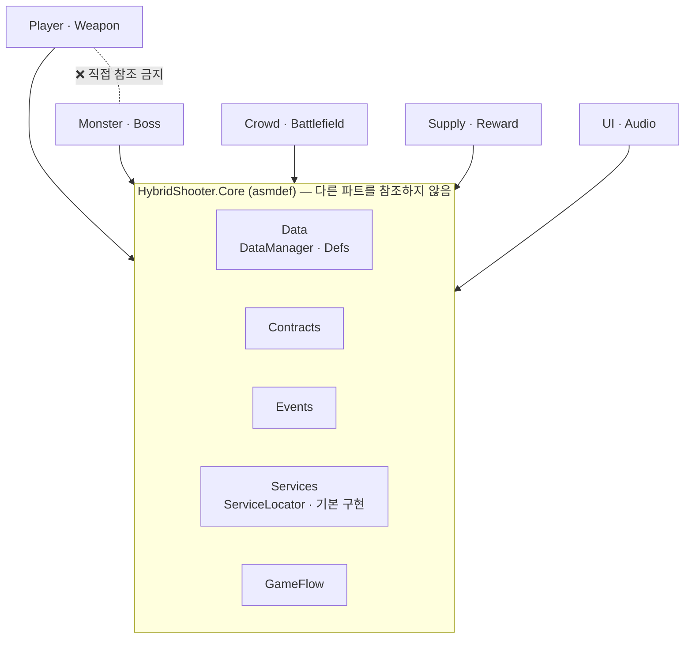
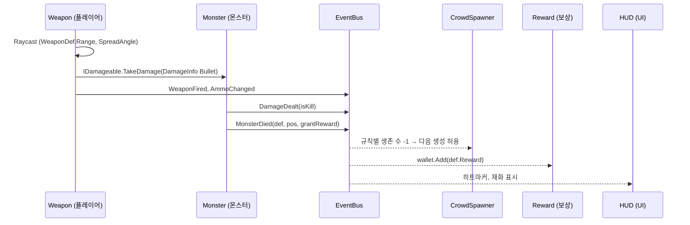
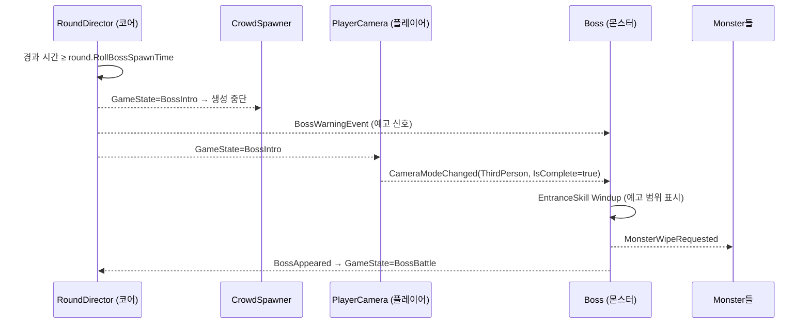

# 파트 간 의존성 & 인터페이스 설계

> 담당: 코어 · 상태: **제안 (팀 리뷰 후 확정)** · 최종 수정: 2026-10-19
> 백로그별 상세 연결은 [03-BacklogMapping](03-BacklogMapping.md)

## 1. 목표

2주, 4명, 9개 에픽이 동시에 진행된다. 가장 중요한 것은 **"남의 작업을 기다리지 않고 각자 `Test_` 씬에서 Play 해볼 수 있는 것"** 이다.

1. **파트끼리 서로의 클래스를 모른다.** 오직 `HybridShooter.Core` 에만 의존한다
2. **구현이 없어도 돌아간다.** 사운드·몬스터 생성·스폰 위치·재화·강화는 기본 구현이 먼저 등록되어 있다
3. **기획이 바뀌면 TSV 를 고친다.** 시간·수치·조합은 테이블에 있다

## 2. 폴더와 담당 (팀 폴더 규칙 적용)

```
Assets/
├─ Scripts/
│  ├─ Core/          HybridShooter.Core (asmdef)        코어
│  │  ├─ Data/       DataManager, Defs/, Dtos/, Loading/, Editor/
│  │  ├─ Contracts/  IDamageable, IPlayerTarget, IMonsterFactory ...
│  │  ├─ Events/     EventBus<T>, GameEvents
│  │  ├─ Services/   ServiceLocator, 기본 구현
│  │  └─ GameFlow/   GameState, (RoundDirector)
│  ├─ Player/        이동·시야·체력·카메라 전환            플레이어·무기
│  ├─ Weapon/        라이플·수류탄·강화 적용                플레이어·무기
│  ├─ Monster/       일반 몬스터 5종, 과밀 제어             몬스터·보스
│  ├─ Boss/          보스 등장·패턴                        몬스터·보스
│  ├─ Crowd/         시간대별 군중 생성 (BL-015)            ★ 합의 필요
│  ├─ Battlefield/   스폰 구역·보급 낙하 구역 (E6)          ★ 합의 필요
│  ├─ Supply/        공중 보급                             보급·보상
│  ├─ Reward/        재화·강화 선택                        보급·보상
│  ├─ UI/            HUD, 강화 화면, 결과                  UI·사운드
│  └─ Audio/         SoundService                         UI·사운드
├─ Prefabs/<같은 기능명>/   Scenes/ (Main, Test_*)   Animations/<기능명>/ ...
├─ Resources/<기능명>/      PrefabKey 로 로드하는 프리팹 (Unity 예약 폴더)
└─ StreamingAssets/Tables/  기획 TSV (Unity 예약 폴더)
```

## 3. 의존성 규칙



- **허용**: 모든 파트 → `HybridShooter.Core`
- **금지**: 파트 ↔ 파트 직접 참조
- Core 는 asmdef 라서 Core 가 다른 파트를 참조하면 **컴파일 에러** — 규칙이 컴파일러로 강제된다

## 4. 통신 방법 3가지

| 상황 | 방법 | 예 |
|---|---|---|
| 대상을 이미 들고 있음 (레이캐스트·충돌·폭발 범위) | **인터페이스** | 라이플 명중 → `IDamageable.TakeDamage` / 회복 팩 → `IHealable.Heal` |
| 씬 전역 기능 요청 | **`ServiceLocator.Get<T>()`** | `IMonsterFactory.Spawn`, `ISpawnZoneProvider`, `IUpgradeState`, `ISoundService` |
| 일어난 일 알리기 (듣는 쪽 0~N) | **`EventBus<T>`** | `MonsterDiedEvent` → 재화 + 군중 카운트 + UI + 사운드 |

> 판단 기준: 결과(반환값)가 필요하면 인터페이스/서비스, 알리기만 하면 이벤트.

## 5. 계약 (`Scripts/Core/Contracts/`)

| 계약 | 구현 | 사용 | 등록 / 기본 구현 |
|---|---|---|---|
| `IDamageable` + `DamageInfo` | 플레이어, 몬스터, 보스 | 라이플, 수류탄, 몬스터 공격, 보스 패턴 | 컴포넌트 (`collider.TryGetDamageable`) |
| `IPlayerTarget` (Root, AimPoint, **ViewPoint**) | 플레이어 | 몬스터 추적, 침투형 시야 판정, 스폰 위치 | `ServiceLocator.Register` |
| `IHealable`, `IGrenadeReceiver`, `IHealPackReceiver` | 플레이어 | 보급 획득 | 컴포넌트 (플레이어 루트) |
| `IPlayerLives` (Lives, MaxLives, SetMaxLives, AddMaxLives, AddLives) | 플레이어 | 난이도 설정, 스테이지 클리어 보상 | `ServiceLocator.Register` |
| `IMonsterFactory` | 몬스터 (풀링) | 군중 생성, 보스 등장 | 기본: `ResourcesMonsterFactory` |
| `ISpawnZoneProvider` | 전장 | 군중 생성, 보급 낙하 | 기본: `RingSpawnZoneProvider` (플레이어 주변 링) |
| `ISoundService` | UI·사운드 | 전원 | 기본: `NullSoundService` |
| `ICurrencyWallet` | 보상 | 재화 획득, 강화 구매 | 기본: `CurrencyWallet` |
| `IUpgradeState` | 보상 | 무기(능력치 계산), 강화 화면 | 기본: `UpgradeLedger` |

## 6. 이벤트 (`Scripts/Core/Events/GameEvents.cs`)

| 이벤트 | 발행 | 구독 |
|---|---|---|
| `GameStateChangedEvent`, `RoundStartedEvent`, `GameOverEvent` | 코어 | 전원 (입력 잠금, BGM, 화면 전환) |
| **`RoundCleanupEvent(FullReset)`** | 코어 | **전원** — 자기 몬스터·투사체·보급·타이머 정리 |
| `BossWarningEvent` | 코어 | 몬스터(보스 준비), UI·사운드(지진음·조명) |
| `PlayerHpChangedEvent`, `PlayerDamagedEvent` | 플레이어 | UI·사운드(피격 표현) |
| `PlayerDiedEvent` (사망, 부활 가능) | 플레이어 | 몬스터(대상 놓기), UI·사운드(사망 연출) |
| `PlayerRevivedEvent` (부활 연출 끝) | 플레이어 | 몬스터(대상 다시 잡기), UI·사운드 |
| `PlayerFinalDeathEvent` (최종 사망) | 플레이어 | **코어(게임오버)**, UI |
| `PlayerLivesChangedEvent(Current, Max)` | 플레이어 | UI (목숨 표시) |
| `CameraModeChangedEvent(Mode, IsComplete)` | 플레이어 | 보스(전환 완료 후 등장 공격), UI |
| `AmmoChangedEvent`, `WeaponFiredEvent`, `ReloadStarted/FinishedEvent` | 무기 | UI(HUD), 사운드 |
| `GrenadeCountChangedEvent`, `GrenadeExplodedEvent` | 무기 | UI, 몬스터(돌진형 유인 아이디어) |
| `HealPackCountChangedEvent` | 플레이어 | UI |
| `DamageDealtEvent` | 피해를 준 쪽 | UI(히트마커), 몬스터 피격 연출 |
| `MonsterSpawnedEvent`, `MonsterDiedEvent(GrantReward)` | 몬스터 | 군중 생성(카운트), 보상(재화), UI·사운드 |
| `MonsterWipeRequestedEvent` | 보스(등장 공격) | 몬스터 |
| `BossAppearedEvent`, `BossSkillPhaseChangedEvent`, `BossDamageStageChangedEvent`, `BossDefeatedEvent` | 보스 | 코어, UI·사운드, 보상 |
| `SupplyDroppedEvent`, `SupplyCollectedEvent` | 보급 | UI(낙하 위치 표시), 사운드 |
| `CurrencyChangedEvent`, `UpgradePurchasedEvent` | 보상 | UI, 무기(능력치 갱신) |
| `RewardSelectionFinishedEvent` | UI(강화 화면) | 코어(다음 라운드) |

구독은 반드시 짝으로:

```csharp
void OnEnable()  => EventBus<RoundCleanupEvent>.Subscribe(OnRoundCleanup);
void OnDisable() => EventBus<RoundCleanupEvent>.Unsubscribe(OnRoundCleanup);
void OnRoundCleanup(RoundCleanupEvent e) { /* 내 오브젝트·코루틴 정리, e.FullReset 이면 초기 상태로 */ }
```

## 7. 핵심 시나리오

### 7-1. 군중전: 라이플로 몬스터 처치



### 7-2. 보스 등장: 시점 전환 → 등장 공격



## 8. 하지 말 것 (리뷰에서 반려)
- 다른 파트 폴더 클래스를 `using` / `GetComponent` / `FindObjectOfType`
- 수치 하드코딩 → 테이블 또는 `ConfigTable`
- Def 에 런타임 상태 저장, DTO 를 게임 코드에서 사용
- `OnEnable` 구독 후 `OnDisable` 해제 누락, `RoundCleanupEvent` 미처리
- 새 싱글톤 추가 (필요하면 `ServiceLocator`)

## 9. 열린 질문 (팀 합의 필요)
- [ ] E6 전장, BL-015 군중 생성 담당
- [ ] 보스 등장 공격으로 정리된 잡몹에게 재화를 줄지 (`MonsterWipeRequestedEvent.GrantReward`)
- [ ] 라운드가 올라갈 때 난이도 변화 방식 (RoundTable 행 추가 vs 배율 컬럼)
- [ ] 리소스 로드: `Resources` 로 시작, 여유 있으면 Addressables
