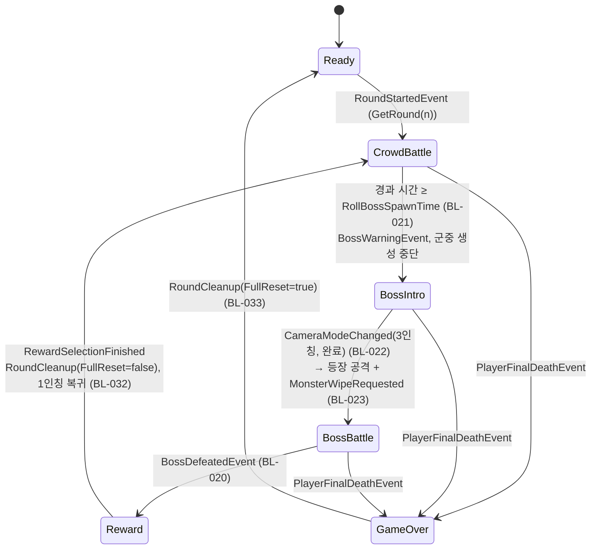

# 백로그 ↔ 시스템 연결표

> Asana 백로그(BL-001~033)가 어떤 데이터·계약·이벤트를 쓰는지. 카드 작업 전에 "내가 쓸 것 / 내가 발행할 것"을 확인하는 용도.
> 담당 열은 제안이며 ★ 는 팀 합의 필요.

## 라운드 한 바퀴

상태 머신(`RoundDirector`)은 `Scripts/Core/GameFlow/` 에 두고 `GameStateChangedEvent` 로 알린다.

## 백로그별 연결

| BL | 내용 | 에픽 | 담당(제안) | 데이터 | 계약/서비스 | 발행 이벤트 | 구독 이벤트 |
|---|---|---|---|---|---|---|---|
| 001 | 이동·지형 충돌 | E1 | 플레이어 | PlayerDef.MoveSpeed | — | — | GameStateChanged(입력 잠금) |
| 002 | 1인칭 시야 | E1 | 플레이어 | PlayerDef.LookSensitivity/Pitch | — | CameraModeChanged | — |
| 003 | 라이플 사격 | E2 | 플레이어 | WeaponDef | IDamageable | WeaponFired, DamageDealt | — |
| 004 | 탄약·재장전 | E2 | 플레이어 | WeaponDef.MagazineSize/ReloadTime | IUpgradeState | AmmoChanged, ReloadStarted/Finished | UpgradePurchased |
| 005 | 수류탄 | E2 | 플레이어 | GrenadeDef, PlayerDef.Start/MaxGrenades | IDamageable | GrenadeCountChanged, GrenadeExploded | — |
| 006 | 피격·사망 | E1 | 플레이어 | PlayerDef.MaxHp, Config.PlayerInvincibleTime | IDamageable, IHealable | PlayerHpChanged, PlayerDamaged, PlayerDied, PlayerRevived, PlayerFinalDeath, PlayerLivesChanged | — |
| 007 | 피격·위험 표현 | E1 | UI·사운드 (+플레이어) | Config.LowHpRatio | ISoundService | — | PlayerDamaged, PlayerHpChanged |
| 008 | 개활지·외곽 벽 | E6 | ★ | — | — | — | — |
| 009 | 건물·엄폐물·고지대 | E6 | ★ | — | ISpawnZoneProvider(구역) | — | — |
| 010 | 근접형 | E3 | 몬스터 | MonsterDef(Melee) | IPlayerTarget, IDamageable, IMonsterFactory | MonsterSpawned, MonsterDied | RoundCleanup, MonsterWipeRequested |
| 011 | 위치 압박형 독안개 | E3 | 몬스터 | MonsterDef(PoisonFog) + Skill `PoisonFog` | IPlayerTarget | — | 〃 |
| 012 | 침투형 | E3 | 몬스터 | MonsterDef(Infiltrator) | IPlayerTarget.ViewPoint, ISoundService | — | 〃 |
| 013 | 공중 공격형 | E3 | 몬스터 | MonsterDef(Aerial) | 〃 | — | 〃 |
| 014 | 돌진형 무리 | E3 | 몬스터 | MonsterDef(Charger) | 〃 | — | GrenadeExploded(유인 아이디어) |
| 015 | 시간대별 조합·밀도 | E4 | ★ | RoundDef.SpawnRules, Config.SpawnSafeRadius | IMonsterFactory, ISpawnZoneProvider | — | MonsterSpawned/Died, GameStateChanged |
| 016 | 과밀 시 대기·선회 | E4 | 몬스터 | Config.CrowdNearRadius/CrowdMaxNear | IPlayerTarget | — | — |
| 017 | 피격 부위·저체력·처치 표현 | E3 | 몬스터 (+UI·사운드) | Config.MonsterLowHpRatio | — | — | DamageDealt |
| 018 | 보급 투하 | E7 | 보급·보상 | RoundDef.Supply*, SupplyDef | ISpawnZoneProvider | SupplyDropped | GameStateChanged, RoundCleanup |
| 019 | 보급 획득 | E7 | 보급·보상 | SupplyDef | IHealable, IGrenadeReceiver | SupplyCollected | — |
| 020 | 보스 피해·처치 | E5 | 몬스터 | MonsterDef(Boss) | IDamageable | BossDefeated | — |
| 021 | 보스 등장 예고 | E5 | 코어 + 몬스터 | RoundDef.BossSpawnTimeMin/Max | — | BossWarning | — |
| 022 | 3인칭 자동 전환 | E1 | 플레이어 | Config.CameraTransitionTime | — | CameraModeChanged | GameStateChanged(BossIntro) |
| 023 | 등장 공격·잡몹 정리 | E5 | 몬스터 | MonsterDef.EntranceSkill | — | BossAppeared, MonsterWipeRequested | CameraModeChanged |
| 024~026 | 강타·돌진·포격 | E5 | 몬스터 | MonsterSkillDef (Windup/Recover/Param) | IDamageable | BossAttack.PhaseChanged (지역) | — |
| 027 | 패턴 전환·반복 | E5 | 몬스터 | MonsterDef.PickPattern | — | BossAttack.PhaseChanged (지역) | — |
| 028 | 보스 상태 표현 | E5 | 몬스터 + UI·사운드 | Config.BossDamageStageRatios | — | (안테나 개방 미구현) | BossAttack.PhaseChanged (지역) |
| 029 | 처치 재화 자동 획득 | E8 | 보급·보상 | MonsterDef.Reward, RoundDef.BossReward | ICurrencyWallet | CurrencyChanged | MonsterDied, BossDefeated |
| 030 | 강화 선택·구매 | E8 | 보급·보상 + UI | UpgradeTrackDef | IUpgradeState, ICurrencyWallet | UpgradePurchased, RewardSelectionFinished | GameStateChanged(Reward) |
| 031 | 강화 실제 적용 | E2 | 플레이어 | UpgradeTrackDef | IUpgradeState | AmmoChanged, GrenadeCountChanged | UpgradePurchased |
| 032 | 강화 유지 다음 라운드 | E9 | 코어 | GetRound(n+1) | — | RoundStarted, RoundCleanup(false) | RewardSelectionFinished |
| 033 | 사망 후 재시작 | E9 | 코어 | — | ICurrencyWallet.ResetTo, IUpgradeState.ResetAll | RoundCleanup(true), GameOver | PlayerFinalDeath |
