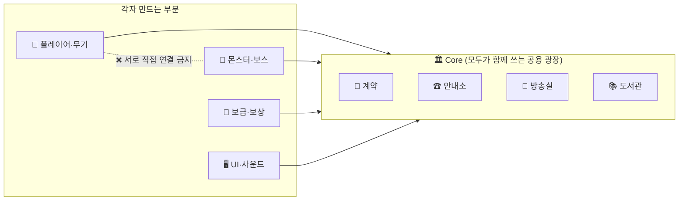
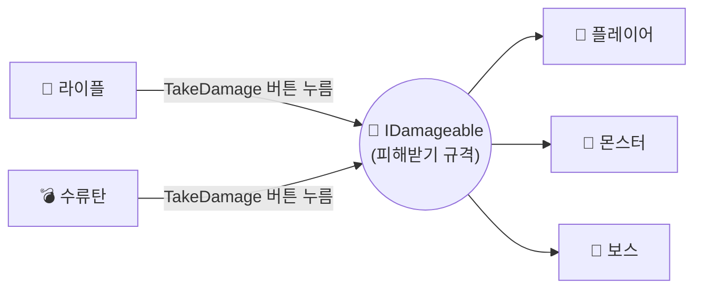
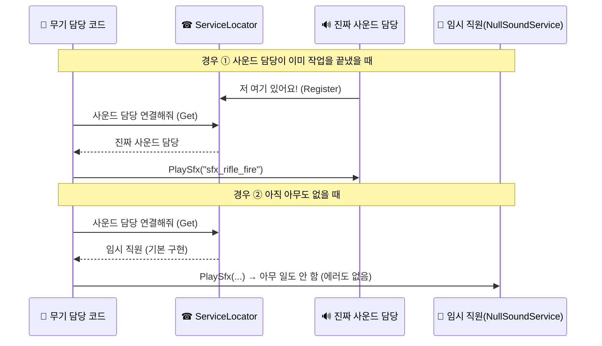
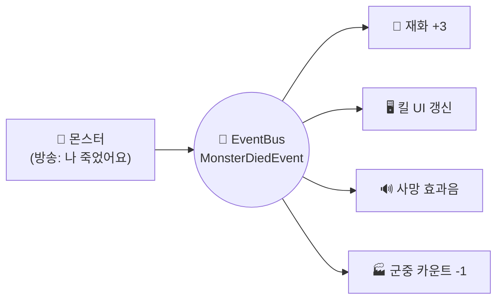
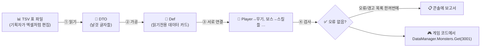
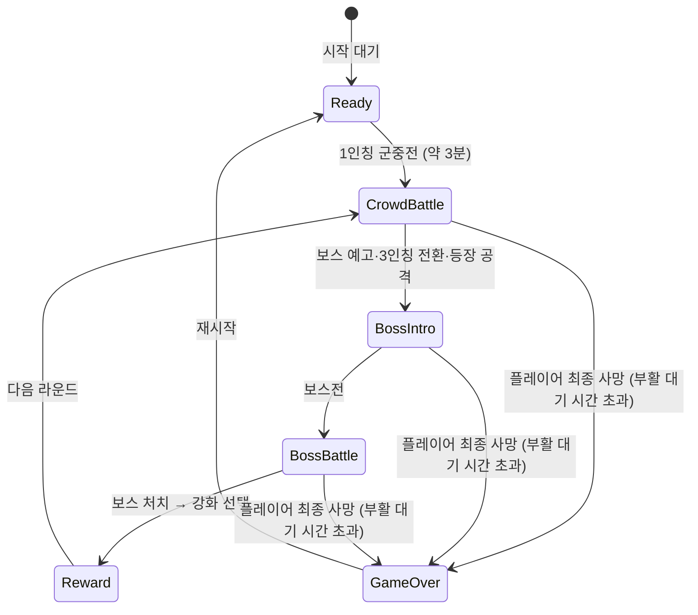
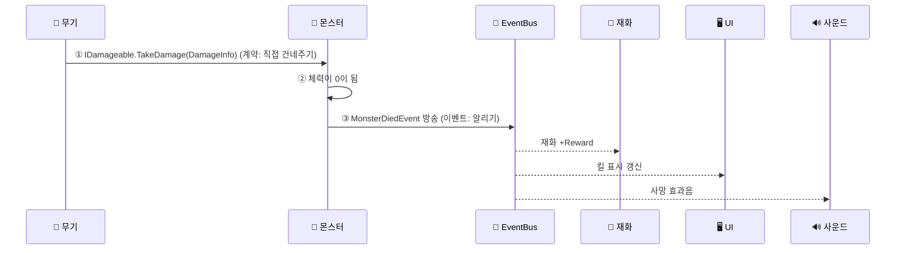

# 코드 구조 이해하기 (비전공자용)

> 이 문서는 **"우리 프로젝트의 뼈대 코드가 왜 이렇게 생겼고, 어떻게 돌아가는지"** 를 설명합니다.
> 코드를 읽을 줄 몰라도 괜찮습니다. 비유와 그림 위주로 썼습니다.
> 실제로 코드를 짜는 방법(복사해서 쓸 수 있는 예제)은 [02-API-사용법](02-API-사용법.md) 에 있습니다.
>
> ⚠ 현재 구조는 **임시 구현**입니다. 데이터 테이블 내용은 바뀔 예정이고, 구조도 달라질 수 있습니다. (커밋 `63f95cc`)

---

## 0. 한 장 요약

우리 팀은 4명이 동시에 서로 다른 기능(플레이어, 몬스터, UI…)을 만듭니다.
이때 가장 무서운 건 **"내 코드가 남의 코드에 엉켜서, 남이 안 끝나면 나도 못 하는 상황"** 입니다.

그래서 코어(Core)에 **공용 규칙 4가지**를 미리 만들어 두었습니다.

| # | 이름 | 한 줄 비유 | 한 줄 설명 |
|---|---|---|---|
| 1 | **Contract (계약)** | 🧾 **계약서** | "이런 일을 할 수 있는 물건은 이런 버튼을 가져야 한다" 라는 약속 |
| 2 | **ServiceLocator** | ☎ **114 안내 / 전화번호부** | "사운드 담당이 누구야?" 를 대신 찾아주는 곳 |
| 3 | **EventBus** | 📢 **학교 방송실** | "몬스터 죽었어요!" 하고 방송하면 듣고 싶은 사람만 듣는다 |
| 4 | **DataManager** | 📚 **기획서 도서관** | 수치(체력, 데미지…)는 전부 여기서 빌려 쓴다 |



> **핵심 규칙 딱 하나:** 내 파트에서 다른 사람 폴더의 코드를 직접 가져다 쓰지 않는다.
> 서로 대화할 때는 **항상 Core 광장을 거친다.**

---

## 1. 왜 이런 구조인가? (식당 비유)

### ❌ 나쁜 구조: 모두가 서로를 직접 안다

주방장이 손님 얼굴을 알고, 손님이 설거지 담당 이름을 알고, 설거지 담당이 계산원 전화번호를 아는 식당.
→ 설거지 담당이 휴가 가면 **식당 전체가 멈춥니다.**

### ✅ 좋은 구조: 모두가 "주문서·호출벨·메뉴판"만 안다

```
 손님 ──(주문서 양식)──▶ 주방    주문서 양식이 같기만 하면 누가 요리하든 상관없음
 주방 ──(호출벨 울림)──▶ 모두    "7번 나왔습니다!" → 해당 손님만 가져감
 모두 ──(메뉴판 한 권)──▶ 같은 가격표 보고 일함
```

| 식당 | 우리 프로젝트 |
|---|---|
| 주문서 양식 | **Contract (계약, interface)** |
| "음식 담당 불러줘" 안내 데스크 | **ServiceLocator** |
| 호출벨 / 방송 | **EventBus** |
| 메뉴판(가격표) | **DataManager + TSV 테이블** |

**얻는 이점**
- 📦 **내 씬(`Test_` 씬)에서 혼자 Play 해볼 수 있다.** 남의 작업이 안 끝나도 "기본 구현"이 대신 동작합니다.
- 🔧 **기획이 바뀌면 코드가 아니라 TSV(엑셀 같은 표)만 고친다.**
- 🧯 **한 사람의 버그가 다른 사람 코드를 멈추지 않는다.** (EventBus가 막아줌)

---

## 2. 폴더 지도

```
Assets/Scripts/
├─ Core/                     ← 🏛 공용 광장 (HybridShooter.Core)
│   ├─ Contracts/            🧾 계약서 모음   (누가 무엇을 할 수 있는지 약속)
│   │    ├─ CombatContracts   · 피해를 주고받는 약속 (IDamageable)
│   │    ├─ PlayerContracts   · 플레이어 관련 약속 (IPlayerTarget, IHealable …)
│   │    └─ ServiceContracts  · 씬 전체 기능 약속 (몬스터 생성, 사운드, 재화, 강화 …)
│   ├─ Events/               📢 방송실
│   │    ├─ EventBus          · 방송 장치 본체
│   │    └─ GameEvents        · 방송 목록 (몬스터 죽음, 라운드 시작 …)
│   ├─ Services/             ☎ 안내소
│   │    ├─ ServiceLocator    · 안내소 본체
│   │    └─ DefaultServices   · 담당자가 없을 때 대신 일하는 "임시 직원"들
│   ├─ Data/                 📚 기획서 도서관
│   │    ├─ DataManager       · 사서(司書). 모든 수치의 유일한 창구
│   │    ├─ Defs/             · 완성된 "데이터 카드" (MonsterDef, WeaponDef …)
│   │    ├─ Dtos/             · 표에서 막 읽은 "날것" (게임 코드에서는 쓰지 않음)
│   │    └─ Loading/          · 표 읽는 도구, 오류 보고서
│   └─ GameFlow/GameState     🚦 게임 진행 단계 목록
│
├─ Player/ Weapon/           🧍 플레이어·무기 담당  ┐
├─ Monster/ Boss/            👾 몬스터·보스 담당    │ 각자 자기 폴더에서만 작업
├─ Crowd/ Battlefield/       🌍 군중·전장 (담당 미정)│ (지금은 대부분 빈 폴더)
├─ Supply/ Reward/           🎁 보급·보상 담당      │
└─ UI/ Audio/                🖥 UI·사운드 담당      ┘

Assets/StreamingAssets/Tables/   ← 📊 기획 데이터(TSV 파일) 보관함
```

> 🔒 **자동 안전장치:** Core는 "asmdef" 라는 칸막이로 둘러싸여 있어서,
> Core가 몰래 Player/Monster 코드를 가져다 쓰면 **컴파일 에러**가 납니다.
> 즉, "규칙 위반"을 사람이 아니라 프로그램이 막아줍니다.

---

## 3. 네 가지 도구를 하나씩 이해하기

### 3-1. 🧾 Contract (계약) — "이 버튼만 있으면 누구든 OK"

**비유: 콘센트 규격**
전자제품(플레이어·몬스터·보스)이 뭐든 상관없이, **플러그 모양(규격)이 같으면** 벽 콘센트(공격하는 쪽)에서 전기를 줄 수 있습니다.



- 라이플은 "맞은 게 몬스터인지 보스인지" **몰라도** 됩니다. "`IDamageable` 이면 `TakeDamage`" 면 끝.
- 새로운 적을 만들어도 `IDamageable` 만 지키면 **라이플 코드를 한 줄도 안 고쳐도** 맞습니다.

**현재 존재하는 계약서 목록**

| 계약 | 누가 "구현"(제공)하나 | 누가 "사용"하나 | 쉬운 설명 |
|---|---|---|---|
| `IDamageable` | 플레이어, 몬스터, 보스 | 총, 수류탄, 몬스터 공격 | 💥 "나는 맞을 수 있어요" |
| `IPlayerTarget` | 플레이어 | 몬스터, 스폰 | 🎯 "나(플레이어)는 여기 있어요" 위치 안내판 |
| `IHealable` | 플레이어 | 보급(회복팩) | 💊 "나는 회복될 수 있어요" |
| `IGrenadeReceiver` | 플레이어 | 보급(수류탄) | 💣 "나는 수류탄을 받을 수 있어요" |
| `IMonsterFactory` | 몬스터 담당 | 군중 생성, 보스 등장 | 🏭 "몬스터 만들어주는 공장" |
| `ISpawnZoneProvider` | 전장 담당 | 군중 생성, 보급 | 📍 "어디에 놓을지 알려주는 안내원" |
| `ISoundService` | UI·사운드 담당 | 모두 | 🔊 "소리 틀어주는 사람" |
| `ICurrencyWallet` | 보상 담당 | 보상, 강화 | 👛 "돈 지갑" |
| `IUpgradeState` | 보상 담당 | 무기, 강화 화면 | 📈 "구매한 강화 기록장" |

**공통 데이터 상자: `DamageInfo`**
"한 번의 공격"에 대한 정보를 한 상자에 담은 것입니다. (얼마나 아픈지, 총인지 폭발인지, 누가 쳤는지, 어디를 맞았는지, 어느 방향인지)
총·수류탄·몬스터·보스 **모두 같은 상자**를 씁니다.

**진영(`Faction`)**: 플레이어 / 몬스터 / 중립. 같은 편끼리는 맞지 않게 `CanBeHitBy` 로 걸러냅니다.

---

### 3-2. ☎ ServiceLocator — "114 안내 데스크"

**비유:** 우리 반 전화번호부.
"사운드 담당 누구야?" 하고 물으면 → 그 순간 **씬에 있는 담당자**를 알려줍니다.



**왜 좋은가?**
- 무기 담당은 **사운드 담당이 작업을 시작하기도 전에** `PlaySfx(...)` 를 미리 써둘 수 있습니다.
- 나중에 진짜 사운드가 등록되면 **무기 코드를 안 고쳐도** 소리가 납니다.

**"임시 직원"(기본 구현, Fallback) 명단** — 담당자가 없어도 게임이 돌아가는 이유

| 계약 | 임시 직원 | 하는 일 |
|---|---|---|
| `ISoundService` | `NullSoundService` | 아무것도 안 함 (조용) |
| `IMonsterFactory` | `ResourcesMonsterFactory` | `Resources` 폴더에서 프리팹을 꺼내 그냥 생성 |
| `ISpawnZoneProvider` | `RingSpawnZoneProvider` | 플레이어 주변 **도넛(링) 모양**에서 위치 계산 |
| `ICurrencyWallet` | `CurrencyWallet` | 숫자 하나로 재화 관리 |
| `IUpgradeState` | `UpgradeLedger` | 강화 레벨 기록 |

> ⚠ **`IPlayerTarget` 은 임시 직원이 없습니다.** 플레이어 담당이 등록해야 합니다.
> (그래서 사용할 때는 "없을 수도 있다"를 생각하고 `TryGet` 을 쓰는 게 안전합니다 → [02-API-사용법](02-API-사용법.md))

**주의:** 서로 다른 두 개가 같은 계약에 등록하면 **나중 것이 이긴다**(경고 로그가 뜸).

---

### 3-3. 📢 EventBus — "학교 방송실"

**비유:** 방송실에서 "방금 몬스터가 죽었습니다!" 라고 방송하면,
- 재화 담당은 듣고 → 돈을 올리고
- UI 담당은 듣고 → 킬 표시를 올리고
- 사운드 담당은 듣고 → 효과음을 틀고
- 군중 생성 담당은 듣고 → "한 마리 줄었네, 다음 거 만들자"

**방송하는 사람은 누가 듣는지 모릅니다. 듣는 사람이 0명이어도, 10명이어도 상관없습니다.**



**방송 종류(이벤트)는 "타입 하나 = 방송 채널 하나"** 입니다.
`MonsterDiedEvent` 채널은 `MonsterDiedEvent` 만 흘립니다.

**꼭 지켜야 할 약속: "라디오는 켰으면 끈다"**
방송을 듣기 시작(`Subscribe`)했으면, 꺼질 때 반드시 듣기 해제(`Unsubscribe`)합니다.
안 끄면 **이미 사라진 오브젝트에게 방송이 계속 전달되어** 에러가 납니다. (가장 흔한 버그!)

```
오브젝트가 켜질 때(OnEnable)  → 라디오 켜기 (Subscribe)
오브젝트가 꺼질 때(OnDisable) → 라디오 끄기 (Unsubscribe)     ← 짝으로!
```

**안전장치**
- 듣는 사람 중 한 명이 에러를 내도 **나머지는 계속 방송을 듣습니다.**
- 플레이를 다시 시작하면 듣는 사람 명단이 **자동으로 초기화**됩니다.

#### 🔀 "서비스 호출" vs "이벤트 방송" 언제 뭘 쓰지?

| 상황 | 비유 | 도구 |
|---|---|---|
| **결과가 필요하다** ("몬스터 하나 만들어줘 → 만든 걸 돌려줘") | 📞 전화로 주문 | **ServiceLocator** |
| **알리기만 하면 된다** ("몬스터 죽었음") | 📢 방송 | **EventBus** |
| **지금 눈앞에 있는 대상**에게 ("방금 총알이 맞은 저 녀석") | 🤝 직접 건네주기 | **Contract(IDamageable 등)** |

---

### 3-4. 📚 DataManager — "기획서 도서관 + 사서"

**비유:** 도서관 사서에게 "몬스터 3001번 책 주세요" 하면 **읽기만 가능한 카드**를 빌려줍니다.
(체력, 속도, 공격력이 적혀 있지만, 낙서(수정)는 못 합니다.)



**용어 번역표**

| 용어 | 쉬운 말 | 규칙 |
|---|---|---|
| **TSV** | 탭으로 구분된 표 파일 (엑셀로 열림) | 기획 수치는 여기에만 둔다 |
| **DTO** | 표에서 막 읽은 날것 | ❌ **게임 코드에서 절대 쓰지 않음** |
| **Def** | 정리된 데이터 카드 (예: `MonsterDef`) | ✅ 게임 코드는 이것만 사용. **읽기 전용** |
| **DataManager** | 사서. 모든 Def의 유일한 창구 | 별도 로드 코드 필요 없음 (첫 접근 때 자동 로드) |

**⭐ 가장 중요한 구분: "설계도(Def)" vs "현재 상태"**

> 🧁 **쿠키 틀(Def)** 은 모든 쿠키가 똑같이 씁니다. (최대 체력 20)
> 🍪 **구워진 쿠키 하나하나(몬스터 개체)** 는 각자 상태가 다릅니다. (현재 체력 7)

- `MonsterDef.MaxHp` = 쿠키 틀. 바꾸면 안 됨.
- "현재 체력", "남은 탄약", "강화 레벨" = **각자(그 파트가) 따로 들고 있는 상태.**

**현재 있는 도서관 책장(테이블)**

| 책장 접근 | 담긴 것 | 쉬운 설명 |
|---|---|---|
| `DataManager.Player` | `PlayerDef` | 플레이어 체력·속도·무기 연결 |
| `DataManager.Weapons` | `WeaponDef` | 라이플 데미지·연사·장탄 |
| `DataManager.Grenades` | `GrenadeDef` | 수류탄 데미지·범위 |
| `DataManager.Monsters` | `MonsterDef` | 일반 몬스터 + 보스 (`Role` 로 구분) |
| `DataManager.MonsterSkills` | `MonsterSkillDef` | 몬스터/보스의 공격 패턴 |
| `DataManager.Rounds` / `GetRound(n)` | `RoundDef` | 라운드별 보스·보급 시간 |
| `DataManager.CrowdSpawnRules` | `CrowdSpawnRuleDef` | "몇 초부터 어떤 몬스터를 몇 마리" 규칙 |
| `DataManager.Supplies` | `SupplyDef` | 보급품 종류·확률 |
| `DataManager.Upgrades` / `UpgradeTracks` | `UpgradeDef` | 강화 단계·비용·효과 |
| `DataManager.Sounds` | `SoundDef` | 사운드 키·경로·볼륨 |
| `DataManager.Config` | `GameConfig` | 전역 상수 (스폰 반경, 보스 단계 …) |

**자동 검사 (오탈자 방지 장치)**
표를 고치다 실수하면(없는 몬스터 ID 연결, 체력 0 등) 로드할 때 **오류를 전부 모아서 한 번에** 보여줍니다.
상단 메뉴 `Tools > Data > Validate Tables` 로 **Play 없이도** 검사할 수 있습니다. (커밋 전에 한 번 돌리기!)

---

## 4. 전체 그림: 한 라운드가 돌아가는 모습

> 🚧 **현재 코드 상태:** 상태 목록(`GameState`)과 이벤트 목록은 만들어져 있지만,
> 라운드를 실제로 진행시키는 **`RoundDirector`(사회자 역할)는 아직 구현 전**입니다. 아래는 "설계상 흐름"입니다.

### 4-1. 게임 진행 단계 (`GameState`) 🚦



(이 외에 `Paused` 일시정지 상태가 있습니다.)

### 4-2. 몬스터 한 마리를 잡았을 때, 누가 뭘 하나 🎬



우리가 만든 세 가지 도구가 **자연스럽게 역할을 나눠 가진** 모습입니다.
- ① 눈앞의 대상 → **계약**
- ③ 알림 → **이벤트**
- 수치(Reward 값)는 → **DataManager**

---

## 5. "내 일을 하려면 어떤 도구를 쓰지?" 빠른 선택표

| 내가 하고 싶은 것 | 쓰는 것 | 이유 |
|---|---|---|
| 맞은 대상에게 피해 주기 | `IDamageable` (계약) | 누가 맞았는지 몰라도 되게 |
| 소리 틀기 | `ServiceLocator.Get<ISoundService>()` | 담당자가 아직 없어도 호출 가능 |
| 몬스터 만들기 | `ServiceLocator.Get<IMonsterFactory>()` | 풀링 등 구현은 몬스터 담당 몫 |
| 플레이어 위치 알기 | `ServiceLocator.TryGet<IPlayerTarget>()` | 플레이어 클래스를 직접 안 건드림 |
| 재화 올리고 쓰기 | `ServiceLocator.Get<ICurrencyWallet>()` | 지갑은 하나로 공유 |
| "무슨 일이 일어났다" 알리기 | `EventBus<…Event>.Publish` | 듣는 사람 수와 상관없이 |
| "그 일이 일어나면 반응하기" | `EventBus<…Event>.Subscribe` | OnEnable/OnDisable 짝으로 |
| 수치(체력·데미지·시간) 쓰기 | `DataManager.…` | 코드에 숫자 박지 않기 |

---

## 6. 하지 말아야 할 것 (코드 리뷰에서 반려됨) 🚫

| ❌ 하지 마세요 | 왜? | ✅ 대신 |
|---|---|---|
| 다른 파트 폴더의 클래스를 `using` / `GetComponent` / `FindObjectOfType` | 그 사람이 코드를 바꾸면 내 코드가 깨짐 | 계약 / ServiceLocator / EventBus |
| 코드에 숫자 박기 (`hp = 20`) | 기획이 바뀔 때마다 코드를 열어야 함 | TSV 테이블 또는 `Config` |
| `Def` 안에 현재 체력 같은 "변하는 값" 저장 | 모든 몬스터가 같은 Def를 공유하므로 **전부 같이 바뀜** | 각자 자기 변수로 |
| `DTO`를 게임 코드에서 사용 | 날것이라 검사·연결이 안 되어 있음 | `Def` 만 사용 |
| `Subscribe` 해놓고 `Unsubscribe` 안 함 | 사라진 오브젝트에 방송이 가서 에러 | `OnEnable`/`OnDisable` 짝 |
| `RoundCleanupEvent` 를 무시 | 라운드가 끝나도 내 몬스터·투사체가 남음 | 받으면 내 것 전부 정리 |
| 새 싱글톤(`static Instance`) 만들기 | 파트끼리 다시 엉켜버림 | ServiceLocator |

---

## 7. 용어 사전 📖

| 용어 | 한마디 |
|---|---|
| **Contract / interface** | "이 기능을 가진 것"이라는 약속. 내용(구현)은 없고 이름표만 있음 |
| **구현(Implement)** | 약속을 실제로 지키는 코드를 짜는 것 |
| **ServiceLocator** | 약속 이름으로 실제 담당자를 찾아주는 안내소 |
| **Register / Unregister** | 안내소에 "저 여기 있어요" 등록 / 등록 해제 |
| **Fallback(기본 구현)** | 담당자가 없을 때 대신 일하는 임시 직원 |
| **EventBus** | 방송 장치 |
| **Publish / Subscribe** | 방송하기 / 듣기 시작 |
| **Event** | 방송 내용 하나 (`MonsterDiedEvent` 등) |
| **TSV / DTO / Def** | 표 파일 / 날것 / 정리된 읽기전용 카드 |
| **DataManager** | 모든 Def의 단일 창구(사서) |
| **asmdef** | 폴더를 칸막이로 나누는 Unity 설정. Core가 파트를 못 쳐다보게 막음 |
| **Test_ 씬** | 각자 혼자 Play 해보는 개인 연습 씬 |
| **Pooling(풀링)** | 몬스터를 부수지 않고 재활용하는 최적화 |

---

## 8. 현재 상태 한눈에 (정직하게)

| 항목 | 상태 |
|---|---|
| Contracts / EventBus / ServiceLocator / DataManager | ✅ 구현됨 |
| 기본 구현(임시 직원) 5종 | ✅ 구현됨 |
| TSV 테이블 11개 + 검증 | ✅ 구현됨 (**수치는 임시, 바뀔 예정**) |
| `RoundDirector` (라운드 진행 사회자) | 🚧 미구현 (설계에만 있음) |
| 플레이어 / 몬스터 / 보스 / UI 등 각 파트 폴더 | 🚧 대부분 빈 폴더 (각자 채울 곳) |
| 군중 생성(Crowd), 전장(Battlefield) 담당 | ❓ 팀 합의 필요 |

다음으로 읽을 문서 → **[02-API-사용법](02-API-사용법.md)** (실제로 어떻게 쓰는지)
